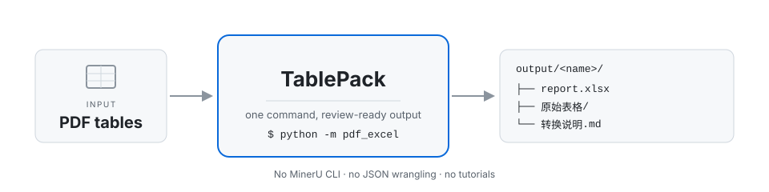
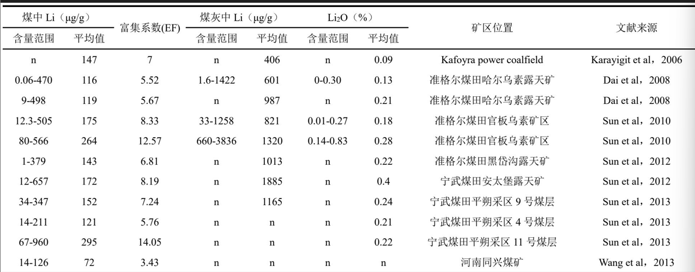
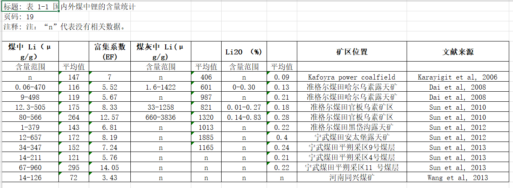

<div align="center">

# TablePack

**PDF tables → multi-sheet Excel packages you can actually accept**

One command: drop in PDFs, get a review-ready Excel package · table-crop screenshots for QC · no MinerU tutorial required

[](https://www.python.org/downloads/)
[](LICENSE)
[](https://github.com/opendatalab/MinerU)
[](skills/pdf-table-to-excel/SKILL.md)
[](https://github.com/kujiangmudao/tablepack/actions/workflows/ci.yml)
[](https://github.com/kujiangmudao/tablepack/stargazers)

[简体中文](README.zh-CN.md) · **English** (this page)

[Quick start](#quick-start) · [Preview](#preview) · [Install](#install) · [CLI](#cli) · [Agent skill](#agent-skill) · [Docs](#docs)

</div>



## Why TablePack

[MinerU](https://github.com/opendatalab/MinerU) is a strong parsing engine. But if all you want is "turn the tables in this paper / report into Excel", the last mile is steep: CLI flags, backend choices, `content_list` JSON, export formats. TablePack packs that last mile into one command — with reviewability built in:

- **One PDF → one Excel**, one sheet per table
- **Table-crop screenshots** saved next to every package — QC without extra tooling
- Empty / broken tables → **written into notes, never invented data**
- **Optional SQLite step** (`--import-db`): every package also becomes a typed, deduplicated `<stem>.db` data asset with row-level provenance
- **Optional AI header cleanup** (`--smart`): merged / multi-level headers are flattened into one clear header row by any OpenAI-compatible model, with suspicious values reported in the notes — free models (via the opencode CLI gateway) measure at paid-model quality; see [measured results & cost](docs/smart-model-notes.md)
- Ships with an [agent skill](skills/pdf-table-to-excel/SKILL.md): the same SOP for humans and agents

## Quick start

```bash
git clone https://github.com/kujiangmudao/tablepack.git
cd tablepack
pip install -r requirements.txt

cp examples/demo/demo_sample.pdf pdf/
python -m pdf_excel          # then open output/demo_sample/
```

Prerequisite: MinerU already installed — **installed is all you need; you never have to learn its CLI**. No MinerU yet? Use the one-shot script in [Install](#install).

## Preview

<!-- GIF: replace with  once recorded -->

<p align="center">
  
  &nbsp;&nbsp;
  
</p>

Left: the crop screenshot saved for each table (for review) · Right: the packaged Excel sheet

## Install

### Path A — MinerU already installed

You only need this repo. TablePack finds `mineru` on `PATH` automatically (or reads `mineru_bin` from `config.yaml`).

```bash
git clone https://github.com/kujiangmudao/tablepack.git
cd tablepack
pip install -r requirements.txt
cp config.example.yaml config.yaml   # optional; only if mineru is not on PATH
```

### Path B — No MinerU yet (one-shot install)

The script creates a project-local venv (`.venv-mineru`), installs official `mineru[all]` plus this project's deps, and writes `config.yaml`. It does **not** touch your global site-packages — after setup you only ever run TablePack, never the MinerU CLI by hand.

**Windows (PowerShell)**

```powershell
git clone https://github.com/kujiangmudao/tablepack.git
cd tablepack
powershell -ExecutionPolicy Bypass -File scripts\install_mineru.ps1
.\.venv-mineru\Scripts\Activate.ps1
python -m pdf_excel --dry-config   # verify env & config
```

**Linux / macOS**

```bash
git clone https://github.com/kujiangmudao/tablepack.git
cd tablepack
chmod +x scripts/install_mineru.sh
./scripts/install_mineru.sh
source .venv-mineru/bin/activate
python -m pdf_excel --dry-config   # verify env & config
```

Then follow [Quick start](#quick-start) to run the demo. Full detail: [docs/INSTALL.md](docs/INSTALL.md).

## CLI

| I want to… | Command |
|------------|---------|
| Convert every PDF in `pdf/` | `python -m pdf_excel` |
| Force re-convert and overwrite | `python -m pdf_excel --force` |
| Only convert files not yet converted | `python -m pdf_excel --skip-existing` |
| Only files whose name contains a keyword | `python -m pdf_excel keyword` |
| Also build a SQLite data asset | `python -m pdf_excel --import-db` |
| Build `.db` for existing packages | `python -m pdf_excel.db_import output/<stem>/<stem>.xlsx` |
| Aggregate a batch into one warehouse DB | `python -m pdf_excel --warehouse output/_warehouse.db` |
| Flatten messy headers with an LLM | `python -m pdf_excel --smart` |
| Check environment & config | `python -m pdf_excel --dry-config` |

Each package folder contains **the workbook** (one sheet per table), **table-crop screenshots** for QC, **extracted images**, and **notes** (conversion notes, or an issues file when a table fails).

With `--import-db` (or `import_db: true`), each package additionally contains `<stem>.db` — a SQLite database with one table per sheet (typed columns, `_src_*` provenance columns, exact-duplicate rows skipped with counts, and a `_meta` summary table). With `--warehouse PATH`, all packages of the run are additionally aggregated into one shared database (`<stem>__`-prefixed tables, same provenance and `_meta`).

Folder/file names default to Chinese — set `output_language: en` in `config.yaml` to get English names (`table_crops/`, `images/`, `conversion_notes.md`, `issues.md`).

With `--smart`, an OpenAI-compatible LLM flattens merged / multi-level headers into one clear row (e.g. `工业分析` + `Mad` → `工业分析_Mad`) and reports suspicious cells (OCR slips, inconsistent values) in the notes. Clean tables cost **zero** API calls. Setup: `llm_base_url` + `llm_model` in `config.yaml` (or env `PDF_EXCEL_LLM_BASE_URL` / `PDF_EXCEL_LLM_MODEL`), key in env `PDF_EXCEL_LLM_API_KEY`. No paid API? Free models (mimo-v2.6-flash-free, longcat, step-5, …) match DeepSeek's quality when routed through the local opencode CLI gateway. Measured models & cost: [docs/smart-model-notes.md](docs/smart-model-notes.md).

Inspect a sample package without running anything: [`examples/demo_output/demo_sample_en/`](examples/demo_output/demo_sample_en/)

## Agent skill

Works with OpenCode, Cursor, Claude Code, and any agent that can read a skill file.

| | |
|--|--|
| Skill | [`skills/pdf-table-to-excel/SKILL.md`](skills/pdf-table-to-excel/SKILL.md) |
| Rules | [`AGENTS.md`](AGENTS.md) |
| Invoke | `/pdf-table-to-excel` · or just ask in plain language |

1. Prefer opening **this repo as the workspace** (CLI + skill together)
2. Path B users: activate `.venv-mineru` so agents run in the same environment
3. For visual QC (opening the table-crop images), a **multimodal** model works best

The skill handles both English and Chinese requests.

Drop into any agent (one raw URL):

```text
https://raw.githubusercontent.com/kujiangmudao/tablepack/main/skills/pdf-table-to-excel/SKILL.md
```

## Project layout

```text
tablepack / pdf_excel
├── pdf_excel/                 # Python package (python -m pdf_excel)
├── skills/pdf-table-to-excel/ # agent skill
├── scripts/install_mineru.*   # Path B setup
├── examples/demo/             # synthetic demo PDF
├── docs/INSTALL.md
├── docs/assets/               # README screenshots & flow diagram
└── AGENTS.md
```

## Docs

- [Install (Path A / B)](docs/INSTALL.md)
- [QC checklist](docs/QC_CHECKLIST.md)
- [Architecture](docs/ARCHITECTURE.md)
- [Smart layer: models, results & cost](docs/smart-model-notes.md)
- [Troubleshooting](docs/TROUBLESHOOTING.md)
- [Contributing](CONTRIBUTING.md)

## License & credits

[MIT](LICENSE) · Parsing engine: [MinerU](https://github.com/opendatalab/MinerU) · Excel: [openpyxl](https://openpyxl.readthedocs.io/)

**You own final data correctness — verify against the source PDF before production use.**
